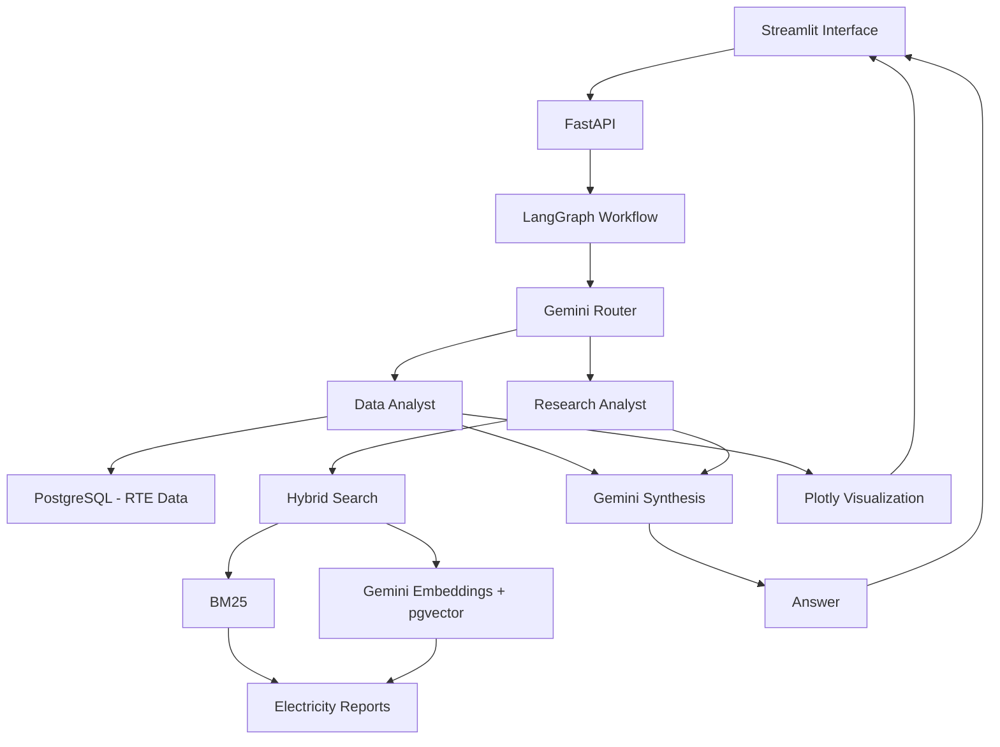

# ⚡ Energy Intelligence

**An AI-powered assistant for analyzing the French electricity system using agentic workflows, Retrieval-Augmented Generation (RAG), and structured energy data.**

Energy Intelligence combines electricity market reports with historical electricity measurements to answer questions, perform numerical analyses, and generate interactive visualizations.

The project demonstrates how Large Language Models (LLMs) can be integrated with document retrieval, SQL databases, and analytical tools to build a domain-specific AI assistant.

**Current status:** Functional local prototype.

## Features

### 1. Document Intelligence — RAG

Ask questions about French and European electricity markets using official reports from RTE and ENTSO-E.

- PDF extraction and document chunking
- Semantic search with Gemini embeddings
- Vector storage with PostgreSQL and pgvector
- Keyword retrieval using BM25
- Hybrid retrieval with Reciprocal Rank Fusion (RRF)
- Grounded answer generation with source references

### 2. Electricity Data Analysis

Analyze historical French electricity consumption and production using RTE éCO2mix data.

- Historical electricity measurements for 2024–2025
- ETL pipeline using Python and Polars
- PostgreSQL storage on Neon
- Yearly and monthly SQL aggregations
- Analysis of nuclear, solar, wind, hydroelectric, fossil fuel and bioenergy production
- Electricity consumption and production comparisons

### 3. LangGraph Orchestration

A LangGraph workflow routes questions to specialized components:

**Data Analyst**
- Queries structured electricity data in PostgreSQL
- Selects annual or monthly aggregations
- Provides numerical results for electricity analysis

**Research Analyst**
- Searches relevant passages in electricity market reports
- Uses hybrid retrieval to identify supporting information

**Synthesis**
- Combines retrieved information and SQL results
- Generates answers using Gemini
- References the available sources

The workflow supports data-only, document-only, and combined analysis.

### 4. Interactive Visualizations

- Automatic Plotly chart generation for supported electricity metrics
- Annual and monthly visualizations
- Interactive HTML charts
- Integration with the application interface

### 5. Web Application

- FastAPI backend exposing the LangGraph workflow
- Streamlit conversational interface
- Conversation display and session history
- Interactive charts embedded alongside generated answers

## Architecture



The database contains both structured RTE electricity measurements and vector embeddings of document chunks.

## Technology Stack

| Component | Technologies |
|---|---|
| Language | Python |
| LLM | Google Gemini |
| LLM integration | LiteLLM |
| Agent orchestration | LangGraph |
| RAG framework | LlamaIndex |
| Embeddings | Gemini Embedding |
| Hybrid retrieval | pgvector, BM25, RRF |
| Database | PostgreSQL, Neon |
| Data processing | Polars |
| PDF extraction | PyMuPDF |
| Backend | FastAPI |
| Frontend | Streamlit |
| Visualization | Plotly |
| Observability | Langfuse |
| Package management | uv |

## Data Sources

### RTE — French Electricity Data

RTE (Réseau de Transport d'Électricité) is the French electricity transmission system operator.

The project uses the public **éCO2mix** dataset to analyze electricity consumption and production in France.

Data includes:
- Electricity consumption
- Nuclear production
- Solar and wind production
- Hydroelectric production
- Gas, coal and oil production
- Bioenergy production

**Period:** 2024–2025

**Stored measurements:**

| Year | Records |
|---|---:|
| 2024 | 17,566 |
| 2025 | 17,516 |
| Total | 35,082 |

Source: [RTE éCO2mix — Open Data Réseaux Énergies](https://odre.opendatasoft.com/explore/dataset/eco2mix-national-cons-def/information/)

### Electricity Market Reports

The RAG knowledge base uses:

- RTE — *Bilan électrique 2024*
- RTE — *Bilan électrique 2025*
- ENTSO-E — Electricity market reports for 2024 and 2025

These documents provide context on electricity consumption, generation, energy markets and system evolution.

## RAG Implementation

### Document Processing

The document ingestion pipeline:

1. Extracts text from PDF reports using PyMuPDF.
2. Splits documents into chunks with LlamaIndex.
3. Generates vector embeddings.
4. Stores chunks and embeddings in PostgreSQL.
5. Creates a vector index for similarity search.

Current configuration:

| Parameter | Value |
|---|---|
| Embedding model | gemini-embedding-001 |
| Embedding dimensions | 768 |
| Chunk size | 512 tokens |
| Chunk overlap | 64 tokens |
| Vector index | HNSW |
| Similarity | Cosine |

### Hybrid Retrieval

The retrieval pipeline combines:

**Semantic search:** finds passages based on embedding similarity.

**BM25:** finds passages based on keyword relevance.

**Reciprocal Rank Fusion:** combines both rankings into a final list of relevant document chunks.

The retrieved context is passed to Gemini to generate grounded answers.

## Evaluation

### Retrieval Benchmark

Evaluated on 30 reference questions linked to document pages.

| Metric | Vector Search | Hybrid Search |
|---|---:|---:|
| Hit@5 | 86.7% | 90.0% |
| MRR@5 | 62.8% | 64.2% |

Hybrid retrieval showed a modest improvement over vector-only retrieval on this evaluation set.

### Generation Evaluation

An initial evaluation was performed using five factual questions.

| Metric | Result |
|---|---:|
| Expected numerical values found | 5/5 |
| Reference pages retrieved | 5/5 |

These results measure the presence of expected values and reference pages. They do not establish overall answer correctness or complete faithfulness to the source documents.

### Observability

Langfuse has been integrated into the RAG pipeline to inspect:
- Retrieval operations
- LLM requests
- Execution latency
- Token usage and estimated costs, where available

Full LangGraph workflow observability is planned.

## Project Structure

```text
energy-intelligence/
├── data/
│   ├── raw/
│   │   ├── reports/
│   │   └── rte/
│   ├── evaluation/
│   ├── quality/
│   └── outputs/
│
├── src/
│   └── energy_intelligence/
│       ├── agents/
│       │   ├── workflow.py
│       │   ├── sql_tools.py
│       │   └── chart.py
│       │
│       ├── api/
│       │   └── main.py
│       │
│       ├── evaluation/
│       │   ├── retrieval_eval.py
│       │   └── generation_eval.py
│       │
│       ├── ingestion/
│       │   ├── rte_etl.py
│       │   └── rte_history.py
│       │
│       └── rag/
│           ├── ingest.py
│           ├── hybrid_search.py
│           └── rag_demo.py
│
├── streamlit_app.py
├── pyproject.toml
├── uv.lock
└── README.md
```

## Getting Started

### Prerequisites

- Python 3.12
- uv package manager
- PostgreSQL database with pgvector
- Google Gemini API key
- Access to the source PDF documents and RTE dataset

### 1. Clone the Repository

```bash
git clone <your-repository-url>
cd energy-intelligence
```

### 2. Install Dependencies

```bash
uv sync
```

### 3. Configure Environment Variables

Create a `.env` file at the project root:

```env
GEMINI_API_KEY=your_gemini_api_key
DATABASE_URL=your_postgresql_connection_string
LLM_MODEL=gemini/your-supported-model

# Optional Langfuse configuration
LANGFUSE_PUBLIC_KEY=your_public_key
LANGFUSE_SECRET_KEY=your_secret_key
LANGFUSE_BASE_URL=https://cloud.langfuse.com
```

Never commit API keys or database credentials to Git.

### 4. Initialize the Data

The application requires the following PostgreSQL tables to be populated:

- `rag_chunks`: document chunks and vector embeddings
- `rte_eco2mix`: historical electricity measurements

For the structured electricity data, run:

```bash
uv run python -m energy_intelligence.ingestion.rte_history
```

This downloads the RTE historical data, applies transformations and loads the measurements into PostgreSQL.

The document index must also be populated using the project's PDF ingestion and embedding pipeline before document-based questions can be answered.

### 5. Start FastAPI

```bash
uv run uvicorn energy_intelligence.api.main:app --reload
```

API documentation:

http://127.0.0.1:8000/docs

### 6. Start Streamlit

Open another terminal:

```bash
uv run streamlit run streamlit_app.py
```

Application:

http://localhost:8501

## API

### Health Check

`GET /health`

Returns the API status.

### Ask a Question

`POST /ask`

Example request:

```json
{
  "question": "Compare nuclear electricity production in France in 2024 and 2025."
}
```

Example response structure:

```json
{
  "answer": "Generated answer based on available data.",
  "route": "data",
  "chart_url": "/charts/example.html"
}
```

The `chart_url` is returned only when a supported chart is generated.

## Example Questions

**Electricity production**

> Compare nuclear electricity production in France between 2024 and 2025.

**Monthly analysis**

> Show the monthly evolution of solar electricity production in 2025.

**Document research**

> According to RTE, how did French electricity consumption evolve in 2024?

**Combined analysis**

> Compare electricity consumption in 2024 and 2025 and explain the main trends using RTE reports.

## Current Limitations

This project is a functional local prototype, with several areas planned for improvement.

- **SQL flexibility:** queries use predefined annual and monthly aggregations rather than unrestricted text-to-SQL.
- **Data completeness:** some RTE measurements are missing or excluded because of timestamp conflicts. Conflicting records are preserved separately for investigation.
- **Energy calculations:** TWh values are estimated from available 30-minute power measurements and may differ from official annual totals.
- **Annual boundaries:** SQL aggregations currently use UTC calendar boundaries.
- **RAG evaluation:** the evaluation dataset remains relatively small, and automated faithfulness evaluation has not been completed.
- **Conversation memory:** Streamlit displays session history, but each backend question is currently processed independently.
- **Visualization:** automatic charts currently support a single recognized metric and yearly or monthly aggregation.
- **Deployment:** the application currently runs locally and is not yet configured for public production use.

## Roadmap

- [x] PDF extraction and vector indexing
- [x] Hybrid RAG retrieval
- [x] Retrieval benchmark
- [x] RTE electricity data ingestion
- [x] PostgreSQL analytical queries
- [x] LangGraph workflow orchestration
- [x] Plotly interactive visualizations
- [x] FastAPI backend
- [x] Streamlit interface
- [ ] Automated tests and workflow validation
- [ ] Extended Langfuse observability
- [ ] Improved SQL analysis tools
- [ ] Additional energy datasets and analytical capabilities
- [ ] Docker containerization
- [ ] Cloud deployment
- [ ] Authentication and API rate limiting

## Purpose

Energy Intelligence is a portfolio project exploring the engineering challenges involved in building reliable AI applications around domain-specific data.

It brings together document retrieval, structured data processing, LLM orchestration, database integration, API development and interactive visualization within a single application.
